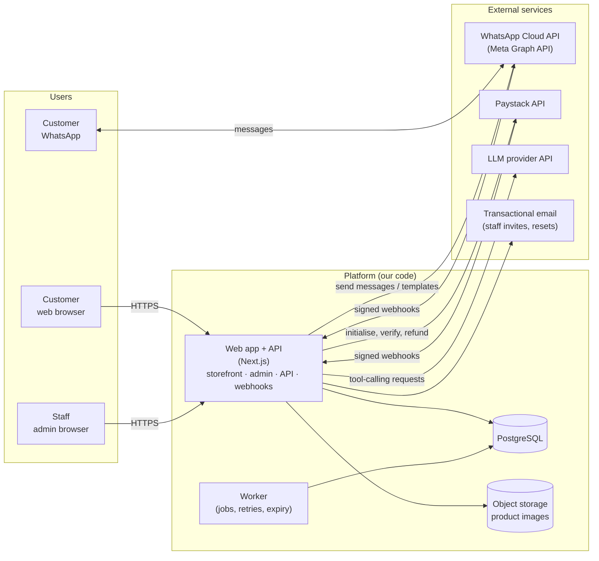
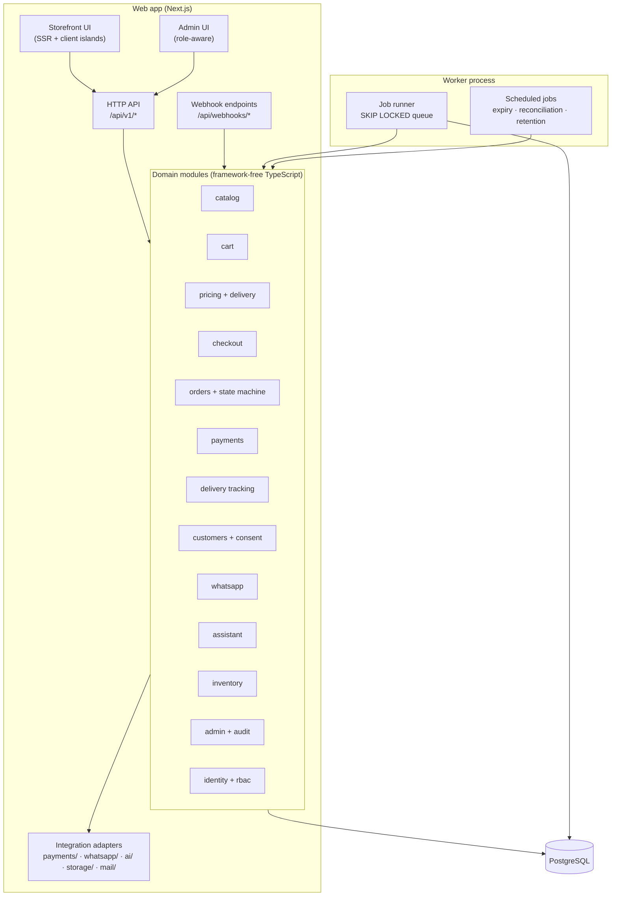
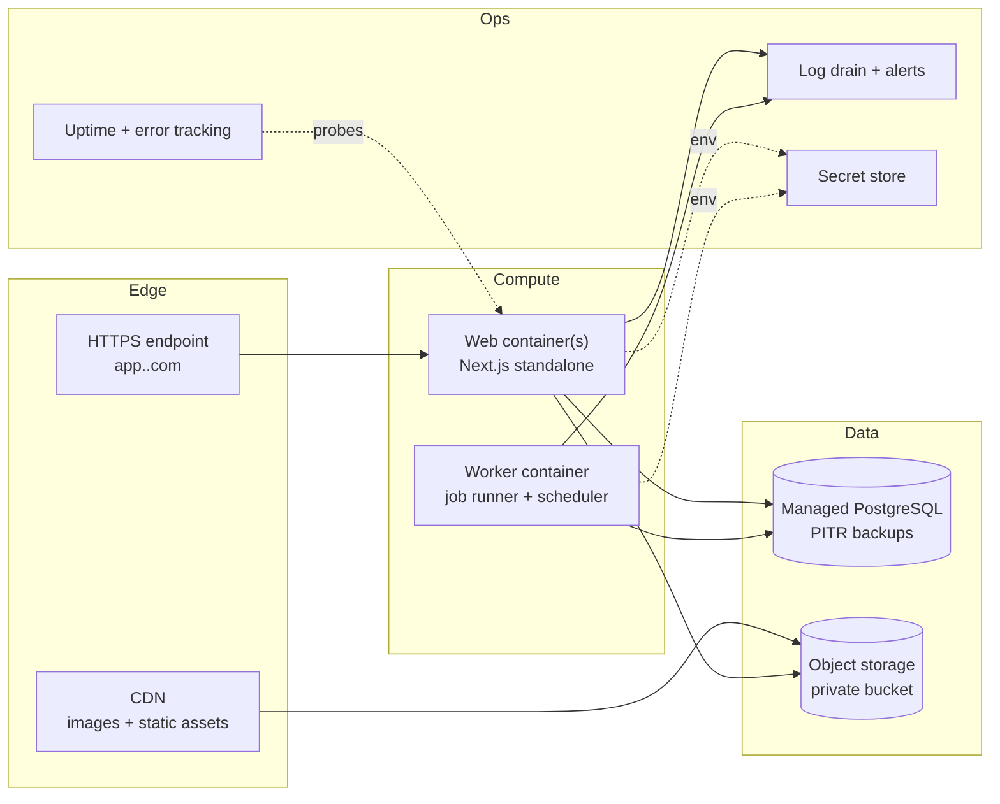

# 02 — Architecture (Phase 2)

Status: **Proposed.** Stack choices are recommendations with trade-offs; §1 lists what would change them.

---

## 1. Technology decisions

| Layer | Choice | Why | Alternatives considered and trade-off |
|---|---|---|---|
| Web app and API | **Next.js (App Router), TypeScript, one deployable** | Storefront needs server rendering for SEO and fast first paint. Admin, storefront and API share types and auth in one codebase. Route handlers host webhooks. | *Separate Node API (Fastify/NestJS) + SPA.* Cleaner boundary and better for a future mobile app, but two deployables, more CI and more auth plumbing for a team of one to three. **Mitigation:** domain code lives in `src/modules/*` with no Next.js imports, so it can be extracted into a service later. |
| UI | **Tailwind CSS + shadcn/ui (Radix primitives)** | Accessible primitives (focus management, ARIA) that we own in the repo. Fast, consistent design tokens. | *MUI / Chakra.* Faster out of the box but heavier bundles and harder to brand per tenant. |
| Database | **PostgreSQL 16+** | Transactions and row locking for stock and idempotency, `CHECK` constraints, `tsvector` full-text search, `pg_trgm`, `SKIP LOCKED` job queue, `jsonb` for flexible attributes. | *MySQL.* Fine, but weaker for the constraint and locking patterns we rely on. |
| ORM and migrations | **Prisma 7 (stable 7.10.x)** | Schema is readable documentation; typed client; versioned migrations. The draft schema validates against Prisma 7.10.1. | *Drizzle.* More SQL-like and lighter at runtime; a strong alternative. Prisma chosen for schema readability. **Trade-offs:** Prisma 7 moves connection URLs to `prisma.config.ts`; `BigInt` needs a JSON serialiser; CHECK constraints, partial indexes and `tsvector` columns need hand-written SQL migrations. |
| Staff authentication | **Auth.js (NextAuth v5), Credentials provider, JWT sessions with short lifetime, revocation via `tokenVersion`** | Established library. Staff sessions are checked against the database on sensitive requests, so deactivation takes effect immediately. | *Managed auth (Clerk, Auth0, Supabase Auth).* Less code, but costs, data residency questions, and a second identity store to reconcile with staff roles. Revisit at multi-tenant SaaS stage. |
| Customer authentication | **Custom passwordless OTP sessions** (OTP via WhatsApp authentication template, hashed codes, opaque session tokens hashed in DB) | Phone-first customers. WhatsApp is the cheapest reliable channel in Nigeria for OTP delivery. No passwords to leak. | *Password accounts.* More friction, more support load. Possible later (D-10). |
| Validation | **Zod** at every boundary: env, HTTP input, webhook payloads, AI tool arguments | One source of truth for shapes and limits. | — |
| Background jobs | **Postgres-backed queue** (`Job` table, `FOR UPDATE SKIP LOCKED`) run by a worker process | No extra infrastructure. Transactional enqueue with the business change (outbox pattern). Enough throughput for MVP volumes. | *BullMQ + Redis.* Better throughput and tooling. Adopt when queue volume or latency requires it; the job interface stays the same. |
| Rate limiting | Postgres-backed fixed-window counters at MVP | No Redis required. | *Redis / Upstash.* Adopt with the queue move. |
| Search | **Postgres FTS (`tsvector`) + `pg_trgm`** | Adequate for a single brand's catalogue; keeps search in the same transaction domain. | *Meilisearch / Typesense / Algolia.* Adopt when catalogue, facets or typo tolerance outgrow Postgres. |
| Images | **S3-compatible object storage + CDN** (e.g. Cloudflare R2 or AWS S3) | Cheap egress with a CDN; presigned uploads keep admin uploads off the app server. | Local disk (not acceptable beyond local dev). |
| WhatsApp | **Meta WhatsApp Business Platform Cloud API, called directly** through a thin client | Official channel, no reseller markup, full control of webhooks and templates. | *Business Solution Provider (e.g. Twilio, 360dialog, Gupshup).* Faster onboarding and a support team, at a markup and with a third party in the data path. The adapter interface allows switching. |
| Payments | **Paystack** first, **Flutterwave** later, both behind a `PaymentProvider` interface, plus a **Mock** provider | Paystack is widely used by Nigerian merchants, supports NGN, has HMAC-SHA512 webhook signing and a verify endpoint. Flutterwave is the natural second adapter. | Direct bank integrations or USSD/mobile money (later, if needed). |
| AI | **LLM provider via a server-side adapter with tool/function calling**; no model vendor SDK is hard-wired into domain code | Keeps the model swappable, keeps keys server-side, and keeps the tool layer under our control. | Agent frameworks (LangChain, etc.). Adds abstraction we do not need for a bounded set of tools. The Vercel AI SDK may be used for streaming in the web chat. |
| Testing | **Vitest** (unit, integration), **Testing Library** (components), **Playwright** (E2E), **Postgres in Docker** for integration, recorded webhook fixtures | Fast feedback; real database behaviour for stock and idempotency tests. | — |
| Hosting | **Container host** (e.g. Render, Railway or Fly.io) for the web app and worker, **managed PostgreSQL** with point-in-time recovery | Long-running worker is simple here. Serverless would need cron and tighter timeouts for the outbox. | *Vercel + managed Postgres + cron-driven worker.* Excellent DX for the web tier. Workable, but splitting the worker into scheduled routes makes retries and backpressure harder. Choose this if the business strongly prefers Vercel (D-06). |

**Versions.** Verified against the npm registry on the build date: Next.js latest stable 16.4.2; Prisma stable line 7.10.x (the `latest` dist-tag is a release candidate and is not used). Pin exact versions at scaffold time (Stage 1).

---

## 2. System context



---

## 3. Containers and modules



**Module rules**

- Domain modules do not import Next.js, React or HTTP types.
- Only the `integrations/*` adapters talk to third-party APIs. Each adapter has a **mock implementation** selected by configuration.
- Cross-module calls go through exported service functions, never another module's tables directly (except read-only reporting queries, which live in `admin`).
- Every service function receives a `Principal` (staff user, customer, conversation actor, webhook, or system) and a `businessId`. Authorisation is checked inside the service, not only in the route.

---

## 4. Proposed repository structure

```text
.
├─ prisma/
│  ├─ schema.prisma                 # proposed MVP data model (validated)
│  ├─ migrations/                   # generated + hand-written SQL (CHECKs, FTS, partial indexes)
│  └─ seed.ts                       # sample business, catalogue, staff (clearly marked as sample)
├─ prisma.config.ts                 # Prisma 7 connection config
├─ src/
│  ├─ app/
│  │  ├─ (storefront)/              # /, /c/[slug], /p/[slug], /cart, /checkout, /orders/...
│  │  ├─ (admin)/admin/             # protected dashboard routes
│  │  ├─ api/v1/                    # public + customer + admin JSON API
│  │  └─ api/webhooks/              # whatsapp, paystack (signature checked before parsing)
│  ├─ modules/                      # domain logic, one folder per capability
│  │  ├─ catalog/  cart/  pricing/  checkout/  orders/  payments/
│  │  ├─ delivery/  customers/  whatsapp/  assistant/  inventory/
│  │  └─ admin/  identity/  audit/
│  ├─ integrations/
│  │  ├─ payments/                  # provider.ts (interface), paystack.ts, mock.ts
│  │  ├─ whatsapp/                  # client.ts, signature.ts, templates.ts, mock.ts
│  │  ├─ ai/                        # provider.ts (interface), tools.ts, mock.ts
│  │  ├─ storage/  mail/
│  ├─ server/                       # db client, env (zod), logger, rate-limit, idempotency, jobs runner
│  ├─ components/                   # ui/ (shadcn), storefront/, admin/, chat/
│  └─ config/brand.ts               # brand defaults, overridden by BusinessSettings
├─ worker/index.ts                  # starts the job runner and scheduler
├─ tests/
│  ├─ unit/  integration/  e2e/
│  └─ fixtures/                     # recorded, sanitised webhook payloads (Meta, Paystack)
├─ docs/                            # this documentation set
├─ .env.example                     # variable names and safe placeholders only
├─ docker-compose.yml               # local Postgres (and optional mail catcher)
├─ Dockerfile                       # web and worker images
└─ .github/workflows/ci.yml         # lint, typecheck, unit, integration, E2E
```

---

## 5. Data flows

### 5.1 Checkout and payment (happy path, with retries)

```mermaid
sequenceDiagram
  autonumber
  actor Cu as Customer
  participant FE as Storefront
  participant API as Checkout API
  participant DB as PostgreSQL
  participant PP as Paystack
  participant WH as Paystack webhook
  participant WK as Worker

  Cu->>FE: Place order (Idempotency-Key = K)
  FE->>API: POST /checkout (K, cart snapshot hash, address, consent)
  API->>DB: BEGIN; check K (scope business+checkout)
  alt K already completed
    DB-->>API: stored response
    API-->>FE: 200 original order (no new rows)
  else new K
    API->>DB: re-price cart; reserve stock (conditional UPDATE); insert Order(PENDING_PAYMENT), Payment(INITIALIZED); store K state
    API->>DB: COMMIT
    API->>PP: initialise transaction (amount in kobo, our reference)
    PP-->>API: authorisation_url
    API->>DB: Payment.status = PENDING, store authorisation_url
    API-->>FE: 201 order + payment URL
  end
  Cu->>PP: Pays on Paystack hosted page (no card data reaches us)
  PP->>WH: charge.success (signed, HMAC-SHA512 of raw body)
  WH->>WH: verify signature over raw bytes
  WH->>DB: INSERT WebhookEvent (unique provider+externalId) — duplicate? stop
  WH-->>PP: 200 OK (fast)
  WH->>DB: enqueue job payment.verify(reference)
  WK->>PP: GET /transaction/verify/{reference}
  PP-->>WK: status, amount, currency, reference
  WK->>DB: BEGIN; check amount/currency/reference; Payment=SUCCEEDED; Order=PAYMENT_CONFIRMED; commit stock; enqueue notification (dedupe key); COMMIT
  WK->>DB: notification job → WhatsApp template (if consent and provider live)
```

**Key properties**

- The redirect back to our site is UX only. It never confirms payment by itself. The verify call is made server-side on webhook receipt, on return, and by reconciliation.
- A duplicate webhook is detected by the unique key on `WebhookEvent` and by the state check on `Payment`. Re-verifying an already-succeeded payment is a no-op.
- If the checkout request is retried after a network failure, the same `Idempotency-Key` returns the original order and payment URL.

### 5.2 WhatsApp inbound message

```mermaid
sequenceDiagram
  autonumber
  participant M as Meta
  participant H as /api/webhooks/whatsapp
  participant DB as PostgreSQL
  participant W as Worker
  participant A as Assistant / menu

  M->>H: POST (X-Hub-Signature-256, raw body)
  H->>H: verify HMAC-SHA256(App Secret, raw body), constant-time
  alt invalid signature
    H-->>M: 401 (logged, no processing)
  else valid
    H->>DB: INSERT WebhookEvent (whatsapp, wamid-based key) ON CONFLICT DO NOTHING
    H-->>M: 200 OK
    H->>DB: enqueue webhook.process(eventId)
  end
  W->>DB: load event; for each message: INSERT Message (providerMessageId unique) — skip duplicates
  W->>DB: update Conversation.lastInboundAt (opens 24h window)
  W->>A: route: mode AI → assistant; mode HUMAN → inbox; STOP → consent withdrawal
  A-->>W: reply plan (text / interactive / template-required)
  W->>DB: enqueue send job with idempotency key
```

### 5.3 Order status change → customer notification

1. Staff (or a delivery event) requests a transition, with `If-Match: <version>`.
2. The state machine validates the transition and the actor's permission.
3. In **one transaction**: update `Order.status` and `version`, insert `OrderStatusEvent`, insert `AuditLog`, and insert a `WhatsAppNotification` (status `PENDING`, `dedupeKey = "{TYPE}:{orderId}:{toStatus}"`).
4. The worker sends the approved template if consent exists and the provider is live. Otherwise it records `SKIPPED_NO_CONSENT` and the dashboard shows it.
5. Provider status callbacks update the notification (`SENT → DELIVERED → READ`), never backwards.

### 5.4 AI assistant turn

1. Inbound message (web or WhatsApp) is stored; the conversation's current mode is checked. Human mode bypasses the model.
2. The orchestrator builds a **bounded context**: system policy, brand facts from settings, the last N turns, the conversation summary, and the verified-customer flag. It excludes other customers' data and internal notes.
3. The model may call only **whitelisted tools**. Each tool receives the acting identity from the server (never from model output), validates arguments with Zod, enforces permissions, and returns structured JSON.
4. The model composes a reply grounded in tool results. Prices, stock and order facts are rendered from structured data where possible.
5. Consequential actions (place order, cancel) produce a **server-rendered confirmation control**. Only the control's callback, carrying a single-use confirmation token, can execute the action.
6. If the model call fails or times out, the deterministic menu is sent instead (`05-whatsapp-and-ai.md` §2.9).

---

## 6. API outline

All JSON APIs live under `/api/v1`. Errors use RFC 9457 `application/problem+json`. Lists use cursor pagination. Money is returned as integer minor units plus a display string.

**Headers:** `Idempotency-Key` (required on `POST /checkout`, `POST /orders/{id}/payments`, refund creation). `If-Match: <version>` (required on order transitions). `X-Request-Id` (generated if absent; echoed in logs).

### 6.1 Public storefront

| Method | Path | Auth | Purpose |
|---|---|---|---|
| GET | `/store/config` | Public | Brand, public policies, feature flags (no secrets) |
| GET | `/catalog/categories` | Public | Category tree |
| GET | `/catalog/products?category=&q=&cursor=&limit=` | Public | Product list |
| GET | `/catalog/products/{slug}` | Public | Product with options, variants, stock state |
| GET | `/cart` | Cart cookie | Current cart with server totals |
| POST | `/cart/items` | Cart cookie | Add variant (quantity validated) |
| PATCH | `/cart/items/{variantId}` | Cart cookie | Set quantity |
| DELETE | `/cart/items/{variantId}` | Cart cookie | Remove |
| POST | `/delivery/quote` | Cart cookie | Fee and estimate label for a state |
| POST | `/checkout` | Cart cookie | Create order `PENDING_PAYMENT` (idempotent) |
| POST | `/orders/{orderId}/payments` | Cart or customer | Initialise or resume payment (idempotent) |
| GET | `/orders/{orderNumber}` | Lookup or customer session | Order status and timeline (after verification) |

### 6.2 Customer identity

| Method | Path | Auth | Purpose |
|---|---|---|---|
| POST | `/auth/otp/request` | Public (rate-limited) | Send OTP for `CUSTOMER_LOGIN` or `ORDER_LOOKUP` |
| POST | `/auth/otp/verify` | Public (attempt-limited) | Verify OTP; issue session cookie |
| POST | `/auth/logout` | Customer session | Revoke session |
| GET | `/me/orders` | Customer session | Order history |
| POST | `/me/orders/{orderId}/cancel` | Customer session + recent OTP | Cancel where allowed |
| POST | `/me/consents` | Customer session | Grant or withdraw a consent purpose |

Built in Stage 5 (customer OTP and order lookup): `POST /api/v1/auth/otp/request`, `POST /api/v1/auth/otp/verify`, `POST /api/v1/auth/logout` and `GET /api/v1/orders/{orderNumber}`. The paths above are shown without the `/api/v1` prefix. The other rows in this table are not built yet. Status and limits: `07` Stage 5.

### 6.3 Assistant

| Method | Path | Auth | Purpose |
|---|---|---|---|
| POST | `/chat/conversations` | Public (rate-limited) | Start web-chat conversation (hashed session id) |
| POST | `/chat/conversations/{id}/messages` | Chat session | Send a user message; returns assistant reply and UI controls |
| POST | `/chat/conversations/{id}/actions` | Chat session | Execute a server-issued control (confirm checkout, verify OTP, handoff) |

### 6.4 Webhooks

| Method | Path | Auth | Purpose |
|---|---|---|---|
| GET | `/api/webhooks/whatsapp` | Verify token | Meta subscription challenge |
| POST | `/api/webhooks/whatsapp` | `X-Hub-Signature-256` | Inbound messages and status updates |
| POST | `/api/webhooks/paystack` | `x-paystack-signature` (HMAC-SHA512) | Payment and refund events |

### 6.5 Admin (staff session + permission per route)

| Method | Path | Permission |
|---|---|---|
| GET | `/admin/overview` | `dashboard.read` |
| GET / POST | `/admin/products` | `catalog.read` / `catalog.write` |
| PATCH | `/admin/products/{id}` | `catalog.write` |
| POST | `/admin/products/{id}/publish` | `catalog.publish` |
| GET / POST / PATCH | `/admin/categories` | `catalog.read` / `catalog.write` |
| POST | `/admin/products/{id}/variants` | `catalog.write` |
| POST | `/admin/variants/{id}/inventory-adjustments` | `inventory.adjust` |
| GET | `/admin/inventory` | `inventory.read` |
| GET | `/admin/orders?status=&q=&from=&to=&channel=&cursor=` | `orders.read` |
| GET | `/admin/orders/{id}` | `orders.read` (customer PII masked unless `pii.reveal`) |
| POST | `/admin/orders/{id}/transitions` | `orders.transition` (per-target rules, §7 of PRD) |
| POST | `/admin/orders/{id}/shipments` | `fulfilment.write` |
| POST | `/admin/shipments/{id}/events` | `fulfilment.write` |
| POST | `/admin/orders/{id}/refunds` | `refunds.request` |
| POST | `/admin/refunds/{id}/approve` | `refunds.approve` |
| POST | `/admin/refunds/{id}/execute` | `refunds.approve` |
| GET | `/admin/orders/{id}/refunds` | `payments.read` (implemented as `payments.view`) |
| POST | `/admin/auth/password` | Staff session (MFA setup not required; allowed while a temporary password is in use) | Change own password with the current one. Other sessions end. The only route a temporary password can use, apart from session and logout. |
| GET | `/admin/payments` | `payments.read` |
| GET | `/admin/customers?q=` | `customers.read` (masked) |
| POST | `/admin/customers/{id}/reveal` | `pii.reveal` (audited, reason required) |
| GET | `/admin/conversations?mode=` | `support.read` |
| POST | `/admin/conversations/{id}/messages` | `support.reply` |
| POST | `/admin/conversations/{id}/assign` / `mode` | `support.reply` |
| GET | `/admin/notifications?status=` | `notifications.read` |
| GET / PUT | `/admin/settings` | `settings.write` |
| CRUD | `/admin/delivery-zones` | `settings.write` |
| CRUD | `/admin/staff` | `staff.manage` |
| GET | `/admin/audit-logs` | `audit.read` |
| GET | `/admin/webhook-events` | `ops.read` |

Staff sign-in uses Auth.js routes under `/api/auth/*`.

---

## 7. Multi-tenancy design

- **Now:** one business row, seeded. Every business-owned table carries `businessId` and every query filters on it.
- **Enforcement layers:** (1) a `TenantContext` resolved from the session or webhook route (WhatsApp `phoneNumberId` → `WhatsAppAccount` → `businessId`; Paystack → payment reference → `businessId`); (2) repository helpers that require `businessId`; (3) a lint rule or code review checklist forbidding raw queries without it; (4) PostgreSQL **row-level security** added before the second tenant goes live, as defence in depth.
- **Later:** per-tenant domains and branding, per-tenant WhatsApp and payment credentials (stored in a secret manager, referenced by ID), tenant-scoped staff login (slug-scoped email uniqueness), and tenant-level usage limits.
- **Identifiers:** UUID v4 primary keys, so IDs are not guessable. Human order numbers are unique per business, and orders are never exposed by number alone.

---

## 8. Security architecture

| Area | Control | Verified by |
|---|---|---|
| Authentication, staff | Argon2id password hashing; lockout after repeated failures; `tokenVersion` revocation; idle and absolute session timeouts; MFA (TOTP) before production. | Auth tests: lockout, revoked token rejected, deactivated user rejected. |
| Authentication, customers | OTP: 6 digits, 10-minute expiry, 5 attempts, 60 s cooldown, 5 sends per phone per hour. Hashed codes (HMAC with server key). Opaque session tokens stored as SHA-256 hashes. | Tests for brute force, reuse, expiry, cross-customer access. |
| Authorisation | Central permission map. Every route and service function checks permission and tenant. Customers see only their own orders. | Role matrix tests (PRD §8) as table-driven tests. |
| Input validation | Zod at every boundary. Max lengths. Enum-only status values. Money as integers. Phone normalised to E.164. | Unit tests with malicious and boundary inputs. |
| Output encoding | React escaping by default; no `dangerouslySetInnerHTML` for user content; markdown from the assistant rendered with a sanitiser. | Review checklist; XSS test payloads in product descriptions. |
| CSRF | `SameSite=Lax` (or `Strict`) cookies, `Origin` check on all mutating requests, CSRF token for cookie-authenticated forms. | Integration tests with foreign Origin. |
| Webhooks | Signature over raw bytes, constant-time comparison; reject unknown tenants; store then process; dedupe; never trust payload status alone (Paystack verify call). | Fixture tests with valid, invalid and replayed signatures. |
| Secrets | Loaded from the host secret store. Validated at boot (zod); the app refuses to start with missing production secrets. Never prefixed `NEXT_PUBLIC_`. Rotation runbook. | CI check that scans for committed secrets (e.g. gitleaks). |
| Logging | Structured logs with redaction for phone, email, address, tokens, OTP codes and authorisation URLs. | Unit test on the redactor. |
| Rate limiting | Per IP and per identifier: OTP send and verify, checkout, chat messages, webhook POSTs (per source), login. | Integration tests that exceed limits. |
| AI safety | Tool allowlist; server-side identity for tools; confirmation tokens; redacted tool audit; no internal notes in context; prompt-injection test cases in the evaluation set. | Evaluation suite (`05-whatsapp-and-ai.md` §2.10). |
| Transport and headers | HTTPS only; HSTS; CSP (nonce-based for scripts); `frame-ancestors` restricted (the chat widget may be embedded only on allowed origins); `X-Content-Type-Options`; `Referrer-Policy: strict-origin-when-cross-origin`. | Header test; security scan in CI (later). |
| Uploads | Type and size validation; image re-encoding; random object keys; private bucket with signed reads for non-public assets. | Upload tests with spoofed MIME types. |
| Data | Encryption at rest (managed DB and bucket); TLS in transit; least-privilege DB roles; the application role cannot update or delete `AuditLog`. | Infrastructure checklist. |
| Dependencies | Lockfile committed; Dependabot or equivalent; `npm audit` in CI with a failing threshold for high severity. | CI. |
| Abuse and fraud | Checkout velocity limits per phone and IP; order-value review threshold (configurable); duplicate-address detection flag for staff. | Integration tests; manual review queue. |

---

## 9. Deployment architecture



**Environments**

| Environment | WhatsApp | Payments | AI | Data |
|---|---|---|---|---|
| **Local** | Mock adapter (simulated inbound messages via fixtures or CLI) | Mock provider + Paystack test keys optional | Mock provider, or a live key with a spend cap | Docker Postgres with seed data |
| **CI** | Mock | Mock | Mock | Ephemeral Postgres service container |
| **Staging** | Meta test number and approved test templates | Paystack test keys | Live key with low cap | Separate database, sample catalogue |
| **Production** | Verified business number, approved templates | Paystack live keys | Live key with monthly budget cap | Production database with PITR |

**Release procedure:** build images in CI → run `prisma migrate deploy` as a release step (expand-then-contract for breaking changes) → start the new web and worker revision → health checks → smoke tests (catalogue read, cart write, webhook GET challenge against staging).

**Configuration:** see `README.md` and the `.env.example` file. Variables are listed there with purpose, whether they are secret, and which environments need them.

---

## 10. External services that need accounts, verification or paid plans

| Service | Needed for | Requirement before live use | Cost model | Repo status |
|---|---|---|---|---|
| **Meta Business Portfolio** | WhatsApp ownership | Business verification by Meta; named admins | Free to create | Not configured |
| **WhatsApp Business Account + dedicated number** | Messaging | Number not in consumer WhatsApp app; display name approval | Per-message pricing (see PRD P-4) | Mock adapter only |
| **Meta App (WhatsApp product)** | Webhooks and Graph API | App Secret, System User access token (stored in secret manager) | — | Not configured |
| **Message templates** | Notifications, OTP | Each template approved by Meta with exact variables | Included in per-message pricing | Templates drafted (see `05` §1.5); none approved |
| **Paystack merchant account** | Payments | Business verification and live approval; test keys for development | Transaction fees (per Paystack pricing) | Mock provider only |
| **LLM provider account** | Assistant | API key, billing with budget cap, data-use terms (no training on our data) | Per-token | Mock provider only |
| **Managed PostgreSQL** | Database | Backups with PITR; private networking | Hosting plan | Local Docker only |
| **Object storage + CDN** | Product images | Bucket policy; CORS for uploads | Storage and egress | Not configured |
| **Container host** | Web and worker | Domain, TLS, secrets, health checks | Hosting plan | Not configured |
| **Transactional email** | Staff invites, password resets | Sending domain verified (SPF, DKIM) | Per-email pricing | Not configured |
| **Error tracking and uptime** | Operations | Project and DSN; alert routing | Plan-based | Not configured |
| **Courier API** (later) | Automatic delivery events | Provider agreement | Per-shipment | Not in MVP |

---

## 11. Observability and operations

- **Logs:** JSON with `requestId`, `businessId`, `actorType`, route, status, latency. No PII (redaction tests).
- **Metrics to watch:** webhook receive and verify failures; payment webhook-to-confirmed latency; checkout success rate; stock-reservation failures; job queue depth and oldest job age; WhatsApp send error codes; AI latency, error rate and fallback rate; LLM spend.
- **Alerts:** signature failures spike; payment confirmed without a matching order (should be impossible); queue age > 5 min; WhatsApp error-rate threshold; database backup failure; 5xx rate.
- **Runbooks** (written in Stage 8): replay a webhook; reconcile a payment; re-send a notification; rotate a secret; disable the assistant; restore from backup.
