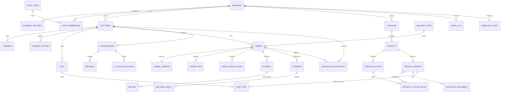

# 03 — Data Model (Phase 2)

The authoritative schema draft is [`prisma/schema.prisma`](../prisma/schema.prisma) (40 models, 29 enums, validated with Prisma 7.10.1). This document explains the design, the rules, and what Prisma cannot express, which must go in hand-written SQL migrations.

---

## 1. Entity map

| Domain | Models | Notes |
|---|---|---|
| Tenancy and settings | `Business`, `BusinessSettings` | Branding, contact, policy text, VAT, reservation window, AI switch |
| Staff and roles | `StaffUser`, `StaffMembership` | Role is per business membership, which allows one person across several brands later |
| Customers and consent | `Customer`, `CustomerSession`, `OtpChallenge`, `ConsentRecord`, `Address` | Phone-first identity. Consent is append-only |
| Catalogue | `Category`, `Product`, `ProductImage`, `ProductOption`, `ProductOptionValue`, `ProductVariant`, `VariantOptionValue` | Options generate variants; a variant is the sellable unit with SKU, price and stock |
| Inventory | `ProductVariant.onHand/reserved`, `InventoryMovement` | Cached balances plus an append-only ledger |
| Delivery | `DeliveryZone`, `Shipment`, `DeliveryEvent` | Zones price shipping. Events form the delivery timeline |
| Carts | `Cart`, `CartItem` | Anonymous or customer-linked. Hashed cookie token |
| Orders | `Order`, `OrderAddress`, `OrderItem`, `OrderStatusEvent` | Snapshots of address, price and product name. Append-only status history |
| Payments | `Payment`, `Refund` | Provider references only. No card data |
| Conversations | `Conversation`, `Message` | WhatsApp and web chat. Mode: AI, HUMAN, CLOSED |
| WhatsApp | `WhatsAppAccount`, `MessageTemplate`, `WhatsAppNotification` | The notification table is the outbox and the admin log |
| Platform | `WebhookEvent`, `Job`, `IdempotencyKey`, `ConfirmationRequest`, `AuditLog`, `AiToolInvocation` | Idempotency, queueing, consent to act, audit |

### 1.1 Mapping to the brief's required data model

| Brief requirement | Covered by |
|---|---|
| Businesses and storefront settings | `Business`, `BusinessSettings` |
| Users and roles | `StaffUser`, `StaffMembership`, `StaffRole` |
| Products, categories, variants, inventory | Catalogue and inventory group |
| Customers and consent preferences | `Customer`, `ConsentRecord` |
| Carts and cart items | `Cart`, `CartItem` |
| Orders and order items | `Order`, `OrderItem`, `OrderAddress`, `OrderStatusEvent` |
| Payments and refunds | `Payment`, `Refund` |
| Addresses and fulfilment records | `Address`, `OrderAddress`, `Shipment` |
| Delivery events | `DeliveryEvent` |
| WhatsApp conversations and message logs | `Conversation`, `Message`, `WhatsAppNotification` |
| AI tool actions and audit records | `AiToolInvocation`, `AuditLog` |

### 1.2 Entity relationships (simplified)



---

## 2. Global conventions

| Concern | Rule |
|---|---|
| Keys | UUID v4 (`@db.Uuid`). Human-readable order numbers are a separate unique column per business. |
| Money | `BigInt` minor units (kobo). Never floats. Totals are stored, not recomputed later, and must match their components (DB check). A signed 64-bit BigInt holds about 9.2×10¹⁸ kobo (roughly ₦92 quadrillion), far beyond any single order or aggregate sale for this business. |
| Time | `timestamptz`. Lagos display is a presentation concern. |
| Soft delete | Products use `deletedAt`, so historical order items keep their references. Other records use status flags or hard delete under the retention rules in §8. |
| Text limits | Every string has a length limit in the schema (`VarChar(n)`) and in Zod. |
| Enumerations | Postgres enums for states that drive logic. Free-text only where the value is informational. |
| Tenancy | `businessId` on every business-owned table. Enforced in repositories now and by row-level security before a second tenant launches. |
| Secrets | Never in the database. The `mode` flag on `WhatsAppAccount` selects the adapter; tokens live in the secret store. |

---

## 3. Order lifecycle implementation

- Statuses are the PRD §7 enum. The transition table lives in code (`src/modules/orders/stateMachine.ts`) and is unit-tested exhaustively: every (from, to, actor) triple is either allowed or rejected.
- Every transition runs in one transaction: `UPDATE "Order" ... WHERE id = $1 AND version = $expected`, then insert `OrderStatusEvent`, `AuditLog` and any side-effect jobs. If the update matches zero rows, the request fails with `409` and nothing else is written.
- The database does not encode the full transition graph (it would be brittle). It enforces the invariants that must never break: non-negative stock, `reserved ≤ onHand`, total arithmetic, unique order numbers, and that `paidAt` is set when status is at or after `PAYMENT_CONFIRMED` (checked in tests and in a nightly reconciliation query).

---

## 4. Inventory rules

Stock is per variant. `onHand` is physical stock; `reserved` is stock promised to unpaid or unfulfilled orders. Available = `onHand − reserved`.

**Reserve** (checkout), one statement per line, inside the checkout transaction:

```sql
UPDATE "ProductVariant"
SET    reserved = reserved + $1, "updatedAt" = now()
WHERE  id = $2
  AND  "businessId" = $3
  AND  "isActive" = true
  AND  ("trackInventory" = false OR (("onHand" - reserved) >= $1));
-- affected rows = 0  →  insufficient stock or inactive variant → roll back the whole checkout
```

**Commit** (payment verified): `onHand = onHand − q, reserved = reserved − q` and insert `InventoryMovement(SOLD)`.
**Release** (cancel, or reservation expiry): `reserved = reserved − q` and insert `InventoryMovement(RESERVATION_RELEASED)`.
**Adjust** (staff): `onHand = onHand + delta` with reason. Must not drop `onHand` below `reserved`. The request fails and the staff member is shown which order holds stock.

Concurrency is handled by the conditional `UPDATE` (atomic check-and-set), not by application-level reads. A concurrency test runs 50 parallel checkouts against 10 units and asserts that exactly 10 succeed and no balance goes negative.

---

## 5. Idempotency and duplicate protection

| Scope | Key | Stored in | Behaviour |
|---|---|---|---|
| Checkout | Client `Idempotency-Key` + business | `IdempotencyKey` (scope `checkout`) and unique `Order(businessId, checkoutKey)` | Same key and body: return the stored response. Same key, different body: `422`. Concurrent in-progress: `409`. |
| Payment initialisation | Order id | `Payment` unique per order while status is `INITIALIZED` or `PENDING` | Reuse the existing authorisation URL. |
| Provider payment | Our reference (`Payment.reference`) | Unique column | Provider retries and duplicate initialisations cannot create two records. |
| Provider transaction | Provider transaction id | Unique `providerTransactionId` | One provider transaction maps to one payment. |
| Payment webhook | Provider event key (`event:data.id:data.status`) | `WebhookEvent` unique (`provider`, `externalId`) | Duplicate event: store nothing new and return `200`. |
| Payment confirmation | Current `Payment.status` | Conditional update `WHERE status IN ('INITIALIZED','PENDING')` | Only the first verification moves the order to `PAYMENT_CONFIRMED`. Later verifications are no-ops. |
| Refund | Refund id; provider refund id | Unique `providerRefundId` | Executing twice is refused by state, not by re-calling the provider. |
| WhatsApp inbound | Message id (`wamid`) | Unique `Message.providerMessageId` | Duplicate deliveries are ignored. |
| WhatsApp status update | Message id + status rank | Update only if new rank > current rank | Out-of-order status events never regress. |
| WhatsApp send | `WhatsAppNotification.dedupeKey` | Unique | One notification per event. Retries reuse the same row. |
| Staff action | `If-Match` version | `Order.version` | Stale edits return `409` with the current state. |
| Confirmation of consequential actions | Token | `ConfirmationRequest.tokenHash`, single-use via `consumedAt` | Replays fail. |

**Retention of idempotency keys:** checkout keys are kept for 7 days, long enough to cover delayed client retries, and then purged. Responses are stored only for successful completions.

---

## 6. Payment rules

- A `Payment` is created in `INITIALIZED`, moves to `PENDING` once the provider returns an authorisation URL, and to `SUCCEEDED`, `FAILED` or `ABANDONED` only through server-side verification or a terminal provider event.
- Verification compares **amount, currency and our reference** with the payment record. Any mismatch sets `FAILED` with a reason and creates a staff task (`Job` of type `payment.mismatch`). The order is not confirmed.
- `amountMinor` on `Payment` equals `Order.totalMinor` at initialisation. If the total changes (it should not, because orders are immutable after checkout), the payment must be re-initialised.
- Refunds: `SUM(Refund.amountMinor WHERE status IN (PENDING, PROCESSING, SUCCEEDED)) ≤ Payment.amountMinor`. Enforced in the service within a locked transaction, then re-checked by a nightly reconciliation query.
- Card data is never received. `Payment.channel` stores only a label such as `card` or `bank_transfer`.

---

## 7. Indexes and access patterns

| Query | Index |
|---|---|
| Storefront product list by business, status, category | `Product(businessId, status)`, `Product(categoryId)` + FTS index (SQL) |
| Product by slug | `Product(businessId, slug)` unique |
| Variant by SKU, by product | `ProductVariant(businessId, sku)` unique, `ProductVariant(productId)` |
| Cart by token hash | `Cart.tokenHash` unique |
| Staff order list by status and date | `Order(businessId, status, createdAt)` |
| Customer order history | `Order(businessId, customerId, createdAt)` |
| Expiry worker | `Order(status, reservationExpiresAt)` |
| Job runner | `Job(status, runAt)` (add a partial index `WHERE status = 'PENDING'` in SQL) |
| Notification retry | `WhatsAppNotification(status, nextAttemptAt)` |
| Conversation inbox | `Conversation(businessId, mode, updatedAt)` |
| Message timeline | `Message(conversationId, createdAt)` |
| Audit search | `AuditLog(businessId, createdAt)`, `AuditLog(businessId, entityType, entityId)` |

---

## 8. Privacy, consent and retention

**Data minimisation.** Collect name, phone, delivery address and optional note. Email is optional. Never collect date of birth, government IDs, or card data. Do not store full WhatsApp profile data.

**Consent ledger.** `ConsentRecord` is append-only. Current state is the latest row per (customer, purpose). Purposes: `ORDER_UPDATES_WHATSAPP`, `MARKETING_WHATSAPP`, `AI_ASSISTANT_PROCESSING`, `TERMS_AND_PRIVACY`. Each record carries source and policy version, so the business can prove what was agreed (NDPA burden of proof).

**Proposed retention schedule** (pending legal review, PRD P-6):

| Data | Retention | Then |
|---|---|---|
| Customer profile (phone, name, email) | While the customer is active | Anonymised within 30 days of an erasure request (`anonymizedAt` set, PII nulled); order and payment records remain linked to the anonymised record |
| Delivery address on `OrderAddress` | Until 90 days after delivery or cancellation | Nulled, keeping city and state for analytics |
| Orders, items, payments, refunds | 6 years from the last activity (confirm with accountant) | Purged or archived according to the accountant's requirement |
| WhatsApp message bodies | 90 days (`Message.retentionUntil`) | Body nulled; metadata and delivery status kept for 1 year |
| WhatsApp notification log | 1 year | Deleted |
| AI tool audit | 1 year; inputs stored redacted | Deleted |
| Webhook payloads (`WebhookEvent.payload`) | 30 days | Payload nulled; identifiers kept for duplicate protection for 1 year |
| OTP challenges | 1 day after expiry | Deleted |
| Customer sessions | 30 days after expiry | Deleted |
| Idempotency keys | 7 days | Deleted |
| Anonymous carts | 30 days after last update | Deleted |
| Job rows | 7 days after success | Deleted |
| Audit logs | 2 years (proposed) | Deleted or archived |
| Consent records | Life of the customer record plus the limitation period set by counsel | Anonymised with the customer |
| Backups | Provider PITR window (e.g. 7–14 days) | Expire automatically. The privacy notice must disclose this |

**Erasure procedure:** an erasure request creates a `Job` that anonymises the customer and their addresses, cancels active carts and sessions, revokes WhatsApp conversation data after retention, and writes an audit entry. Financial rows are kept, as the legal basis (tax and accounting records) overrides erasure for those fields.

**Access controls for PII.** Staff see masked values (`+234 80* *** *678`) by default. Revealing a value requires `pii.reveal`, a reason, and writes an audit entry. Exports of customer lists require `pii.export` and are audited.

---

## 9. What needs hand-written SQL migrations

Prisma's schema language cannot express the items below. They go in migrations after the generated baseline, with a test that asserts each one exists.

```sql
-- Non-negative stock and reservation bound
ALTER TABLE "ProductVariant"
  ADD CONSTRAINT variant_onhand_nonneg CHECK ("onHand" >= 0),
  ADD CONSTRAINT variant_reserved_bounds CHECK ("reserved" >= 0 AND "reserved" <= "onHand"),
  ADD CONSTRAINT variant_price_positive CHECK ("priceMinor" > 0);

-- Cart and order item arithmetic
ALTER TABLE "CartItem"  ADD CONSTRAINT cartitem_qty_range CHECK (quantity BETWEEN 1 AND 99);
ALTER TABLE "OrderItem" ADD CONSTRAINT orderitem_line_math CHECK ("lineTotalMinor" = "unitPriceMinor" * quantity);
ALTER TABLE "Order"     ADD CONSTRAINT order_total_math CHECK ("totalMinor" = "subtotalMinor" - "discountMinor" + "shippingMinor");
ALTER TABLE "Order"     ADD CONSTRAINT order_amounts_nonneg CHECK ("subtotalMinor" >= 0 AND "discountMinor" >= 0 AND "shippingMinor" >= 0);

-- Refund amounts
ALTER TABLE "Refund" ADD CONSTRAINT refund_amount_positive CHECK ("amountMinor" > 0);

-- Paid timestamp invariant (statuses at or after PAYMENT_CONFIRMED)
ALTER TABLE "Order" ADD CONSTRAINT order_paid_invariant CHECK (
  "status" NOT IN ('PAYMENT_CONFIRMED','CONFIRMED','PROCESSING','READY_FOR_DISPATCH',
                   'DISPATCHED','OUT_FOR_DELIVERY','DELIVERED','REFUND_PENDING','REFUNDED')
  OR "paidAt" IS NOT NULL
);

-- Full-text search over products (generated column + GIN index)
ALTER TABLE "Product" ADD COLUMN search_tsv tsvector GENERATED ALWAYS AS (
  setweight(to_tsvector('english', coalesce(name,'')), 'A') ||
  setweight(to_tsvector('english', coalesce("shortDescription",'')), 'B') ||
  setweight(to_tsvector('english', coalesce(description,'')), 'C')
) STORED;
CREATE INDEX product_search_idx ON "Product" USING GIN (search_tsv);
CREATE EXTENSION IF NOT EXISTS pg_trgm;
CREATE INDEX product_name_trgm_idx ON "Product" USING GIN (name gin_trgm_ops);

-- Partial index for the job runner
CREATE INDEX job_pending_idx ON "Job" ("runAt") WHERE status = 'PENDING';

-- Only one open (unconsumed, unexpired) confirmation per cart and action is useful
CREATE UNIQUE INDEX confirmation_one_open_per_cart
  ON "ConfirmationRequest" ("cartId", action) WHERE "consumedAt" IS NULL;
```

The `order_paid_invariant` check is an example of a rule that protects against bugs in code. Keep it, but expect the state-machine tests to catch problems first.

**Reversibility.** Each migration includes a down script or a documented manual rollback. Destructive changes follow expand-then-contract across two releases.

---

## 10. Seed data

`prisma/seed.ts` creates, for local and staging only:

- One business with placeholder brand settings, marked `SAMPLE` in its name.
- Two categories, six products with options, twelve variants, stock levels and placeholder images.
- Two delivery zones with sample fees and labelled sample estimates.
- Three staff users, one per role class (Owner, Manager, Fulfilment), with development-only passwords read from environment variables. The seed refuses to run when `NODE_ENV=production`.
- A sample WhatsApp account in `MOCK` mode and draft templates in `PENDING` status.

The seed never contains real customer data, real phone numbers or real secrets.

---

## 11. Prisma implementation notes

- **Prisma 7 configuration.** The datasource URL is in `prisma.config.ts`, not in `schema.prisma`. The validation error we hit during drafting confirmed this.
- **BigInt serialisation.** JSON responses must convert `BigInt` to strings or numbers. A single serialiser module handles this, with a unit test. Money is always sent as a string of minor units plus a formatted display value.
- **Transactions.** Use interactive transactions with `SELECT ... FOR UPDATE` where a read must be followed by a conditional write, and the conditional `UPDATE` pattern where possible.
- **Raw SQL.** Raw queries always use parameters and include `businessId`. The repository layer is the only place allowed to use `$queryRaw`.
- **Migrations.** `prisma migrate dev` in development; `prisma migrate deploy` in CI and in release. Hand-written SQL files are added to the generated migration folders.
