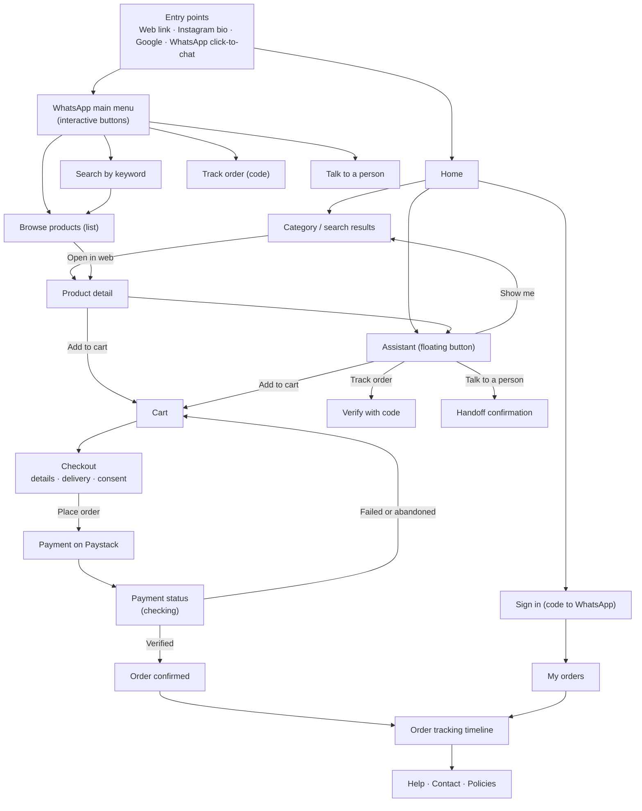
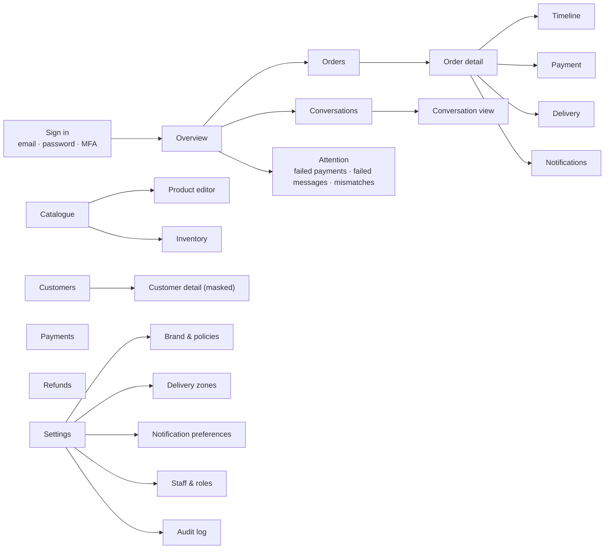

# 04 — UI/UX Design (Phase 3)

These are low-fidelity wireframes and flows. They define structure, content, states and behaviour. Visual styling is applied in Stage 6 from design tokens (§1.2), and a clickable prototype is reviewed before the full build. Example copy in wireframes is illustrative and uses sample products only.

---

## 1. Design foundations

### 1.1 Principles

1. **Mobile first, WhatsApp-literate.** Most visitors arrive on a phone, often via a link shared in WhatsApp. Single-column layouts, thumb-reachable actions, and a short path from link to cart.
2. **Trust is shown, not claimed.** An order is labelled *Paid* only after verification. Payment happens on the provider's page, and the storefront says so. Prices, stock and delivery estimates always state their source.
3. **Never leave the customer guessing.** Every waiting state says what is happening, how long it usually takes, and what to do if it does not finish.
4. **Confirm the things that cost money.** Placing an order and cancelling a paid order each need a visible, specific confirmation step.
5. **Brand-configurable, not brand-hardcoded.** Logo, colours, tagline and policy links come from settings.

### 1.2 Design tokens (defaults, overridden by settings)

| Token | Default | Notes |
|---|---|---|
| `--brand-primary` | `#0F5132` (deep green) | Buttons, links, key highlights. Must pass 4.5:1 on white and on surface. |
| `--brand-accent` | `#F5A524` (amber) | Badges and small highlights only. Not for text on white. |
| `--surface` | `#FFFFFF` | Page background |
| `--surface-muted` | `#F6F7F8` | Cards and sections |
| `--text` | `#1B1F23` | Body text |
| `--text-muted` | `#5B6670` | Secondary text (≥ 4.5:1) |
| `--success` / `--warning` / `--danger` | `#1E7F4F` / `#9A6700` / `#B42318` | Status chips, errors |
| Radius | 12 px cards, 999 px chips, 10 px inputs | |
| Spacing | 4 px base scale | 16 px page gutter on mobile, 24 px on desktop |
| Type | One variable sans-serif, self-hosted. Body 16 px minimum on mobile. Headings scale with viewport. | Avoid font loading that blocks text (use `font-display: swap`) |
| Motion | 150–200 ms ease-out. Disabled under `prefers-reduced-motion`. | |

**Currency and formatting.** `₦12,500` (no decimals for whole naira; show kobo only if non-zero). Dates `12 Oct 2026, 14:20` in Africa/Lagos. Phone shown as `+234 801 234 5678`.

### 1.3 Breakpoints

| Name | Width | Layout |
|---|---|---|
| Compact | 360–599 px | One column; sticky bottom action bar on product and checkout |
| Medium | 600–1023 px | Two-column product grid; side-by-side checkout summary below form |
| Wide | ≥ 1024 px | Four-column grid; checkout with sticky summary on the right |

---

## 2. Navigation and user flows

### 2.1 Customer sitemap and journey



### 2.2 Staff navigation



Navigation is role-aware. Items a role cannot use are hidden, and direct URLs return a server-side 403 page. The UI never relies on hiding alone.

---

## 3. Storefront screens (wireframes)

### 3.1 Home

```text
┌──────────────────────────────────────┐
│ ☰  [Logo]  Brand name        🛒 (2)  │  sticky header
│ 🔍 Search products…                  │
├──────────────────────────────────────┤
│  NEW ARRIVALS                        │
│  ┌──────────────────────────────────┐│
│  │  [ hero image ]                  ││  hero: tagline + CTA
│  │  Tagline in one line             ││
│  │  [ Shop now ]                    ││
│  └──────────────────────────────────┘│
│  Shop by category                    │
│  ( Men ) ( Women ) ( Home ) ( Gifts )│  horizontally scrollable chips
│  Popular right now                   │
│  ┌──────────┐ ┌──────────┐           │  product cards: image, name,
│  │  img     │ │  img     │           │  price, stock chip
│  │ Name     │ │ Name     │           │
│  │ ₦12,500  │ │ ₦8,000   │           │
│  └──────────┘ └──────────┘           │
│  Delivery in Lagos · Pay securely    │  trust strip
│  ─────────────────────────────────── │
│  Footer: policies · contact · WhatsApp│
└──────────────────────────────────────┘
                              (💬 Ask us)   floating assistant button
```

Behaviour: product images lazy-load with fixed aspect ratio to avoid layout shift. "Popular" is a manual curation in MVP, not an algorithm.

### 3.2 Category and search results

```text
┌──────────────────────────────────────┐
│ ← Women                    🛒 (2)     │
│ 🔍 linen dress                       │
│ Filters ▾  Sort: Featured ▾          │  filter sheet on mobile
│ 24 products                          │
│ ┌──────────┐ ┌──────────┐            │
│ │  img     │ │  img     │            │
│ │ Linen A  │ │ Linen B  │            │
│ │ ₦18,000  │ │ ₦22,500  │            │
│ │ ● In stock│ │ ◐ Only 2 left        │
│ └──────────┘ └──────────┘            │
│        … load more (cursor)          │
└──────────────────────────────────────┘
```

**Empty search:** "No products match “linen dress”. Try a shorter word or browse Women." with chips for the top three categories and a button "Ask the assistant".
**Loading:** six skeleton cards with the same dimensions as the real cards.

### 3.3 Product detail

```text
┌──────────────────────────────────────┐
│ ←                             🛒 (2) │
│ ┌──────────────────────────────────┐ │
│ │  image carousel (swipe, dots)    │ │
│ └──────────────────────────────────┘ │
│ Linen Midi Dress                     │
│ ₦18,000   ~~₦21,000~~                │
│ Includes VAT · Prices from our store  │
│ Size                                 │
│ (S) (M) (L) (XL)   ← unavailable greyed│
│ Colour                               │
│ ◉ Sand  ○ Olive                      │
│ ● In stock — ships in 1–2 working days│  business-configured ESTIMATE
│ Quantity  [ − ]  1  [ + ]            │
│ Description …                        │
│ Details: material, care, fit         │  from product attributes
│ Delivery & returns →                 │  links to policy page
├──────────────────────────────────────┤
│ [ Add to cart — ₦18,000 ]            │  sticky bottom bar (compact)
│ Questions? Ask the assistant         │
└──────────────────────────────────────┘
```

**States:** *Combination unavailable* ("This size and colour is not available. Choose another.") disables the button. *Stock changed* (after cart add) shows a banner on the cart page with the new count. *Out of stock* shows "Notify me" only when the business enables it (later).

### 3.4 Cart

```text
┌──────────────────────────────────────┐
│ Your cart (2 items)                  │
│ ┌────┐ Linen Midi Dress              │
│ │img │ Size M · Sand                 │
│ └────┘ ₦18,000   [ − ] 1 [ + ]  Remove│
│ ─────────────────────────────────────│
│ ⚠ Only 1 left in stock. Quantity     │  inline validation
│   has been set to 1.                 │
│ Subtotal            ₦18,000          │
│ Delivery   Choose state at checkout  │
│ Total (incl. VAT)   ₦18,000          │
│ [ Continue to checkout ]             │
│ Keep shopping                        │
└──────────────────────────────────────┘
```

**Empty cart:** "Your cart is empty." Button "Browse new arrivals" and a link "Ask the assistant to find something".
**Price changed since added:** "The price of X changed from ₦A to ₦B." The customer must acknowledge before checkout (checkout returns `409` otherwise).

### 3.5 Checkout (single page, sectioned)

```text
┌──────────────────────────────────────┐
│ Checkout        1 Details · 2 Delivery · 3 Pay │  progress (not a wizard)
│ CONTACT                              │
│ Full name*      [__________________] │
│ WhatsApp number* [+234 ___________]  │  helper: "We send order updates here"
│ Email*          [__________________] │  helper: "For your payment receipt"
│ DELIVERY ADDRESS                     │
│ Street address* [__________________] │
│ City*  [________]  State* [Lagos ▾]  │
│ Landmark (optional) [______________] │
│ Note for the rider (optional)        │
│ DELIVERY                             │
│ ◉ Standard — Lagos Mainland  ₦2,500  │  fee from zone
│   Usually 1–2 working days (estimate)│
│ ○ Free delivery over ₦50,000         │  only if configured
│ UPDATES                              │
│ ☐ Send my order updates on WhatsApp  │  unticked by default
│   Stop at any time by replying STOP. │
│ ☐ I agree to the Terms and Privacy   │  links to policies
│ ───────── Summary (sticky on wide) ──│
│ Items (2)            ₦18,000         │
│ Delivery              ₦2,500         │
│ Total                ₦20,500         │
│ [ Place order and pay ]              │  disabled until valid
│ You will be taken to Paystack to pay.│
│ We never see your card details.      │
└──────────────────────────────────────┘
```

**Behaviour**
- Address state drives the delivery quote (`POST /delivery/quote`). If the state is not covered: "We do not deliver to Kano yet. Contact us on WhatsApp for options." with a link to handoff.
- Validation is inline and on blur, with messages attached to fields (`aria-describedby`). The first error receives focus after submit.
- On submit, the browser sends an `Idempotency-Key`. A double-tap cannot create two orders. The button shows a spinner and stays disabled until the response arrives.
- If stock or price changed: the page lists the changed lines, and the customer re-confirms.

### 3.6 Payment handoff and status

```text
┌──────────────────────────────────────┐
│ Order ORD-260123 created             │
│ ◐ Waiting for payment                │
│ You will be redirected to Paystack.  │
│ [ Pay ₦20,500 now ]                  │
│ Did a payment page not open?         │
│ [ Open payment link ]                │
└──────────────────────────────────────┘

After return from Paystack:
┌──────────────────────────────────────┐
│ ◐ Checking your payment…             │  polls order status every 3 s, max 60 s
│ This usually takes a few seconds.    │  then backs off to 15 s
└──────────────────────────────────────┘
  ↓ verified
┌──────────────────────────────────────┐
│ ✔ Payment received                   │
│ Order confirmed. Updates go to your  │  only if consent given
│ WhatsApp.                            │
└──────────────────────────────────────┘
  ↓ still pending after 2 min
┌──────────────────────────────────────┐
│ We have not received confirmation yet.│
│ If you were charged, do not pay again.│
│ Your order reference: ORD-260123     │
│ [ Check again ] [ Contact us ]       │
└──────────────────────────────────────┘
```

**Failed payment:** "The payment did not go through. No money has been taken for this order." (only when the provider says so). Otherwise "We could not confirm the payment." with retry and contact options. Retry reuses the existing order while the reservation is valid.

### 3.7 Order confirmation and tracking

```text
┌──────────────────────────────────────┐
│ ✔ Order ORD-260123 confirmed          │
│ Paid ₦20,500 on 12 Oct 2026, 14:20    │
├──────────────────────────────────────┤
│ Status timeline                      │
│ ● Payment received      14:20        │
│ ● Order confirmed       14:21        │
│ ● Being prepared        (in progress)│
│ ○ Dispatched                         │
│ ○ Out for delivery                   │
│ ○ Delivered                          │
│ Estimated delivery: 13–14 Oct (estimate)│  or provider-supplied date
├──────────────────────────────────────┤
│ Items · Delivery address · Totals    │
│ Need help? [ Message us on WhatsApp ]│
│ [ Cancel order ] (if allowed)        │  opens confirmation dialog
└──────────────────────────────────────┘
```

**Rules:** the timeline shows only customer-safe text. No internal notes or staff names. Cancellation shows a dialog: "Cancel this order? Items go back to stock. Refunds take up to X working days after approval." (X configured). Requires a verified session.

### 3.8 Sign in with a code

```text
┌──────────────────────────────────────┐
│ See your orders                      │
│ WhatsApp number [+234 ___________]   │
│ [ Send code on WhatsApp ]            │
│                                      │
│ Enter the 6-digit code               │
│ [ _ ] [ _ ] [ _ ] [ _ ] [ _ ] [ _ ]  │  one field per digit, paste supported
│ Code expires in 9:42                 │
│ Resend code (available in 0:58)      │
└──────────────────────────────────────┘
```

**Errors:** "That code is not right. You have 4 tries left." After 5 failures: "Too many attempts. Request a new code in 10 minutes." The message never reveals whether an account exists for the number.

### 3.9 Assistant (web)

```text
┌──────────────────────────────────────┐
│ Shopping assistant          ✕        │
│ AI assistant for [Brand]. I can help │
│ with products, orders and delivery.  │
│ [Browse] [Find something] [Track order]│
│ [Talk to a person]                   │
│ ─────────────────────────────────────│
│ You: something light for Lagos heat, │
│      under ₦15,000                   │
│ Assistant: Here are three in stock:  │
│ ┌─────────┐ ┌─────────┐ ┌─────────┐  │  product cards rendered
│ │ Linen A │ │ Cotton B│ │ Silk C  │  │  by the server
│ │ ₦12,500 │ │ ₦9,000  │ │ ₦14,800 │  │
│ └─────────┘ └─────────┘ └─────────┘  │
│ [Add Linen A to cart]                │
│ ─────────────────────────────────────│
│ [ Type a message…            ] [Send]│
└──────────────────────────────────────┘
```

**Rules:** the assistant identifies itself as an AI assistant. Product cards, prices, stock and buttons are server-rendered from tool results. A disclaimer appears in the header. Human handoff is one tap away. The assistant can be turned off in settings, which shows the menu only.

---

## 4. Admin dashboard (wireframes)

### 4.1 Layout

```text
┌────────┬─────────────────────────────────────────────┐
│ [Logo] │ Overview                 Today ▾  Search ⌕  │
│        ├─────────────────────────────────────────────┤
│ Overview│ KPI cards:  Paid today ₦  | Orders  | To pack│
│ Orders │  Open chats | Failed msgs | Failed payments │
│ Catalog│                                             │
│ Inventory│ Sales chart (paid orders only, by day)     │
│ Customers│ ─────────────────────────────────────────── │
│ Payments │ Needs attention                             │
│ Inbox  │ • 2 payments need review (amount mismatch)  │
│ Messages │ • 1 handoff waiting 14 min                  │
│ Settings │ • 3 WhatsApp messages failed (template)     │
│ Staff  │                                             │
│ Audit  │                                             │
└────────┴─────────────────────────────────────────────┘
```

Left navigation shows only items the user's role may access. Mobile: navigation becomes a bottom sheet; tables become stacked cards.

### 4.2 Orders list

```text
Orders   [Search: order no, phone, name]
Filters: Status ▾  Payment ▾  Channel ▾  Zone ▾  Date ▾   Export (permission)
┌────────────┬──────────┬──────────┬──────────┬─────────┬───────────┐
│ Order      │ Customer │ Total    │ Status   │ Channel │ Placed    │
├────────────┼──────────┼──────────┼──────────┼─────────┼───────────┤
│ ORD-260123 │ +234 80* ***  678 │ ₦20,500 │ ● Confirmed │ WhatsApp │ 14:21 │
│ ORD-260122 │ +234 81* ***  112 │ ₦8,000  │ ◐ Pending pay│ Web      │ 14:02 │
└────────────┴──────────┴──────────┴──────────┴─────────┴───────────┘
Row click → Order detail. Keyboard: arrow keys and Enter.
```

Phone numbers are masked. The status chip shows the lifecycle status. Payment state appears as a separate chip so that "Confirmed" and "Paid" are never confused.

### 4.3 Order detail

```text
ORD-260123   ● Confirmed        Version 4   [Change status ▾]
┌──────────────────────────┬───────────────────────────┐
│ Items (2)                │ Customer                  │
│ Linen Midi · M · Sand    │ Ada O. (name)             │
│ 1 × ₦18,000              │ +234 80* ***  678 [Reveal]│  reveal: role + reason + audit
│ Subtotal ₦18,000         │ Address …                 │
│ Delivery  ₦2,500         │ Note from customer …      │
│ Total    ₦20,500         │ Internal note (staff only)│
├──────────────────────────┴───────────────────────────┤
│ Payment                                              │
│ Paystack · ref ord_123_pay_abc · Succeeded · ₦20,500  │
│ Verified 14:20 · Channel: card                       │
│ [Request refund] (Finance)                           │
├──────────────────────────────────────────────────────┤
│ Delivery                                             │
│ Carrier: In-house · Tracking: —                      │
│ Events  [+ Add event]                                │
├──────────────────────────────────────────────────────┤
│ Timeline (append-only)                               │
│ 14:21 Confirmed (System: payment verified)           │
│ 14:20 Payment received (Webhook → verify)            │
│ 14:02 Pending payment (Customer, Web)                │
├──────────────────────────────────────────────────────┤
│ WhatsApp notifications                               │
│ 14:21 Order confirmed — Delivered ✔                  │
└──────────────────────────────────────────────────────┘
```

**Status change dialog:** shows only the transitions allowed for this role and this order. Required reason for cancellations. Any stale-version conflict reloads the order with a message: "This order was updated by Ife at 14:25. Review and try again."

### 4.4 Product editor

```text
Product: Linen Midi Dress       Status: Draft   [Save] [Publish]
Tabs: Details · Variants · Images · Attributes · SEO

Details: Name* · Slug · Category ▾ · Short description (280) · Description (rich text, sanitised)
Variants:
  Options: Size [S, M, L, XL]   Colour [Sand, Olive]
  ┌──────────┬───────────┬────────┬──────────┬─────────┬────────┐
  │ SKU      │ Variant   │ Price  │ On hand  │ Reserved│ Active │
  │ LMD-S-SND│ S / Sand  │ 18,000 │ 4        │ 1       │ ☑      │
  └──────────┴───────────┴────────┴──────────┴─────────┴────────┘
Images: drag to reorder · alt text required · max 8 · 5 MB each
Publish checklist: ✔ name  ✔ description  ✔ 1 active variant  ✖ alt text missing
```

Price edits create an audit entry showing before and after values. Publishing with unmet checks is blocked, and the missing items are listed.

### 4.5 Inventory

Table of variants with on-hand, reserved, available (computed) and last movement. Adjust opens a dialog: delta, reason (list), note. Negative resulting stock or below-reserved is refused with an explanation.

### 4.6 Conversations inbox

```text
Inbox   [AI] [Waiting for human 2] [Closed]          Assigned to me ☑
┌──────────────────────┬─────────────────────────────────────────┐
│ +234 80* ***  678    │ Conversation with +234 80* ***  678      │
│ Waiting 14 min ●     │ Mode: HUMAN   Window: open (18 h left)   │
│ "Where is my order…" │ ──────────────────────────────────────  │
│                      │ Customer: where is my order ORD-260123  │
│ +234 81* ***  112    │ Summary (AI): verified; asked about rider│
│ AI · 2 min           │ Assistant: I've handed this to a person  │
│                      │ [Reply…                              ] │
│                      │ [Send] [Send template] [Take over] [Close]│
└──────────────────────┴─────────────────────────────────────────┘
```

**Rules:** free-form replies are disabled outside the 24-hour window, and the page offers template sending with a note that it may be charged. The AI summary is labelled as AI-generated. Order details shown here follow the same verification rule as the assistant.

### 4.7 Notifications log, payments, customers

- **Notifications:** table with type, order link, status chip (Pending, Sent, Delivered, Read, Failed, Skipped — no consent), attempts, last error code (human text). Filter "Failed". Retry button for permanent-safe retries only.
- **Payments:** provider, reference, order link, amount, status, verified time. Filter "Needs review" (mismatch, late success, duplicate webhook after success).
- **Customers:** name, masked phone, orders count, last order, consent state per purpose. Detail page shows history. Reveal and export require permissions and log an audit entry.

### 4.8 Settings

- **Brand:** logo upload, primary and accent colours (with contrast warning), tagline, support phone and email.
- **Policies:** delivery, returns, refunds, privacy (rich text). Preview of the storefront footer.
- **Delivery zones:** name, states (multi-select), fee, free-shipping threshold, estimate label. Overlap warning.
- **Commerce:** VAT rate and display mode, stock reservation minutes, per-line maximum, order number prefix (locked after first order).
- **Assistant:** on/off, handoff hours (for the "Talk to a person" promise), disclaimers.
- **WhatsApp:** connection status (mock or live), templates and their approval state, sender display name, test send (staging only).
- **Staff and roles:** invite by email, role dropdown with the permission summary shown beside it, deactivate.
- **Audit log:** filter table.

---

## 5. WhatsApp conversation design (examples)

These examples show intended behaviour. Buttons and list rows are configuration, not hardcoded text. Each button ID is a stable key, so the copy can change without breaking logic.

**Entry from a product page link (click-to-chat):**

```text
Customer: Hi, I'd like to know about the Linen Midi Dress (wa.me link prefilled)
Brand:    Hi! I'm the store's AI shopping assistant. I can help with products,
          your orders and delivery. What would you like to do?
          [Browse new arrivals] [Find something] [Track my order] [Talk to a person]
```

**Recommendation with budget:**

```text
Customer: Something light for Lagos heat under 15k
Brand:    Here are three in stock right now:
          1. Linen Midi Dress — ₦12,500 (sizes S–XL)
          2. Cotton Shirt Dress — ₦9,000 (sizes M–L, 2 left)
          3. Silk Blouse — ₦14,800 (sizes S–M)
          Reply with a number to see details, or tap below.
          [Add 1 to cart] [More options]
```

**Checkout confirmation (the explicit gate):**

```text
Brand:    Please check your order before we place it:
          • Linen Midi Dress × 1, size M, sand — ₦12,500
          • Delivery to Lagos Mainland — ₦2,500
          • Total — ₦15,000 (incl. VAT)
          You will get a Paystack payment link next. Prices and stock are checked again at payment.
          [Place order] [Change items] [Cancel]
```

Only the **Place order** button can start checkout, and the button carries a single-use confirmation token. Typing "yes" does not place an order.

**Order status after verification:**

```text
Customer: where is my order
Brand:    To protect your order, I need to confirm it's you. I'll send a code to
          the number on the order.
          [Send code]
Brand:    Enter the 6-digit code.
Customer: 482 913
Brand:    Thanks, verified. ORD-260123 is out for delivery. Estimated: today,
          between 2 and 6 pm (provider estimate). Need anything else?
```

**Handoff:**

```text
Customer: this is wrong, I want a refund
Brand:    I'm sorry about that. Refund requests are handled by our team. I've passed
          this conversation to a person, who usually replies within business hours
          (Mon–Sat, 9:00–18:00 WAT). You don't need to repeat yourself.
```

**Fallback when the assistant is unavailable:**

```text
Brand:    I can't answer that right now. Choose an option:
          [Browse] [Track order] [Talk to a person]
```

**STOP:**

```text
Customer: STOP
Brand:    You won't receive WhatsApp order updates from us. Reply START to turn them back on.
```

---

## 6. States, errors and copy

| Situation | Pattern | Example copy |
|---|---|---|
| Loading list | Skeleton with fixed dimensions | — |
| Loading action | Button spinner, disabled, `aria-busy` | — |
| Empty list | Message, one clear action, and an alternative | "No orders yet. Find something you love." |
| Network error | Retry button, keep user input | "We could not reach the server. Your details are saved. Try again." |
| Stock changed | Inline banner with the new value | "Only 1 left. We set your quantity to 1." |
| Price changed | Acknowledgement required | "The price changed from ₦18,000 to ₦19,500. Continue?" |
| Delivery not available | Field error plus alternative | "We don't deliver to this state yet. Contact us for options." |
| Payment pending | Waiting state with polling and limits | See §3.6 |
| Payment failed | Explicit, no blame | "The payment did not go through." |
| Session expired | Return to the same step after sign-in | "For your security, please verify again." |
| Assistant unavailable | Deterministic menu | "I can't answer that right now." |
| Server error | Reference id, no internals | "Something went wrong. Reference: 7f3c…. Contact us if this continues." |
| Permission denied (admin) | Explicit page, no data | "You don't have access to this area. Ask the owner." |

---

## 7. Accessibility and quality checklist

- Every interactive element is reachable by keyboard, has a visible focus style (≥ 3:1 contrast against adjacent colours), and has an accessible name.
- Form fields have visible labels (not placeholders only), `autocomplete` attributes (`name`, `tel`, `address-line1`, `postal-code`), and error text linked with `aria-describedby`.
- Status chips use text, not colour alone.
- Product images have alt text (required in admin). Decorative images use empty alt.
- Modals trap focus and return it on close. Toasts are announced politely (`aria-live="polite"`); errors that block progress are announced assertively.
- Touch targets ≥ 44 × 44 px. Tap targets for chips and quantity controls spaced to avoid mis-taps.
- Reduced motion respected. No content relies on hover alone.
- Layout verified at 360, 768 and 1280 px widths; zoom to 200% without loss of content.
- Tested with a screen reader on at least one mobile and one desktop platform before launch (Stage 8).
- Lighthouse and axe checks in CI for the storefront's key pages. Target: accessibility score 95 or higher and no axe violations on critical pages.

---

## 8. Open UX decisions

| ID | Question | Proposed default |
|---|---|---|
| UX-01 | Single-page checkout or a multi-step wizard? | Single page with sections (fewer drop-offs for short forms) |
| UX-02 | Show "Pay on delivery" option? | Not in MVP (see PRD D-02) |
| UX-03 | Should the assistant open automatically on the home page? | No. It is opened by the user. The first visit may show a one-time tip. |
| UX-04 | Store hours for the "Talk to a person" promise. | Business to provide. Placeholder shown in settings. |
| UX-05 | Do customers see a product's stock count? | Only "Only N left" under a threshold (configurable) |
