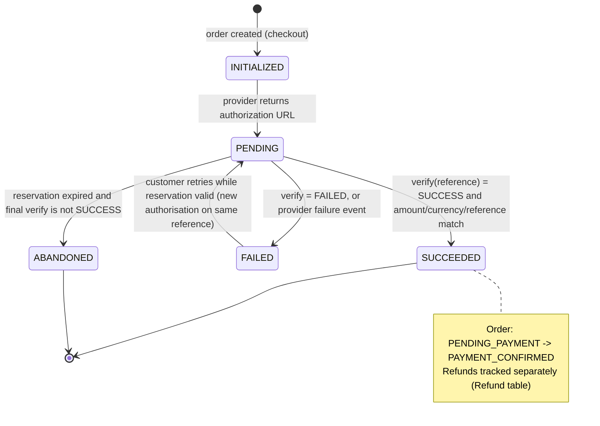

# 06 — Payments (Phase 2 design, Phase 4 implementation)

Status: **Design.** The mock provider is the only implementation planned for Stage 3. Paystack is implemented in Stage 4 and tested against sandbox keys. No live payment is accepted until the activation checklist (§9) is complete.

Field names and event names below reflect Paystack's public documentation at the time of writing. Confirm each one against the current API reference when implementing.

---

## 1. Provider strategy

| Provider | Role | Why |
|---|---|---|
| **Paystack** | Primary, MVP | NGN-native, widely used by Nigerian merchants. Hosted payment page means card data never reaches us. Webhooks are signed with HMAC-SHA512 over the raw body, and there is a verify endpoint. |
| **Flutterwave** | Second adapter (post-MVP) | Useful for redundancy and for merchants who already use it. Webhook authentication is a dashboard secret hash sent in a `verif-hash` header, which is compared in constant time. |
| **Mock** | Development, CI, demos | Same interface and same webhook verification path, with simulated results. Never selectable when `NODE_ENV=production`. |

Selection is by configuration (`PAYMENT_PROVIDER`), one provider per business. Multi-provider routing is out of scope.

**Trade-off noted.** Paystack's hosted page means the customer leaves the storefront and returns. That costs some conversion, but it removes card handling from our scope (PCI DSS obligations stay with the provider) and is the fastest route to a live payment.

---

## 2. Adapter interface

```ts
// src/integrations/payments/provider.ts  (sketch)
export interface PaymentProvider {
  readonly name: 'PAYSTACK' | 'FLUTTERWAVE' | 'MOCK';

  /** Creates a provider transaction for an existing payment record. Idempotent by reference. */
  initialize(input: {
    reference: string;          // our unique reference
    amountMinor: bigint;        // kobo for NGN
    currency: 'NGN';
    email: string;              // required by Paystack; collected at checkout
    callbackUrl: string;
    metadata: { businessId: string; orderId: string; orderNumber: string };
  }): Promise<{ authorizationUrl: string; providerReference: string }>;

  /** Server-side verification. The only source of truth for payment status. */
  verify(reference: string): Promise<VerifiedTransaction>;

  /** Authenticates and parses an inbound webhook. Throws on bad signature. */
  parseWebhook(rawBody: Buffer, headers: Record<string, string | undefined>): ProviderEvent;

  /** Refund for a successful transaction. Asynchronous: final state arrives by webhook or verify. */
  refund(input: { providerTransactionId: string; amountMinor: bigint; reference: string }): Promise<{ providerRefundId: string; status: 'PENDING' | 'PROCESSING' | 'SUCCEEDED' }>;
}

export type VerifiedTransaction = {
  reference: string;
  providerTransactionId: string;
  status: 'SUCCESS' | 'FAILED' | 'ABANDONED' | 'PENDING';
  amountMinor: bigint;
  currency: string;
  channel?: string;        // e.g. card, bank_transfer — never card numbers
  paidAt?: Date;
};
```

Domain code uses only this interface. Provider-specific payload shapes are mapped inside the adapter, and raw provider responses are not persisted beyond a sanitised subset.

---

## 3. Payment lifecycle



**Order interaction.** The order stays `PENDING_PAYMENT` while the payment is `INITIALIZED`, `PENDING` or `FAILED` within the reservation window. Expiry releases stock and moves the order to `CANCELLED` only after a final verification call.

---

## 4. Flows

### 4.1 Initialisation (checkout)

1. Checkout creates the order, reserves stock, and creates `Payment(status = INITIALIZED, reference = pay_<ulid>)`, all in one transaction.
2. After commit, the service calls `initialize`. Amount is taken from the **order total in the database**, never from the request.
3. The response stores `authorizationUrl` and moves the payment to `PENDING`.
4. Repeated calls to `POST /orders/{id}/payments` with the same idempotency key return the stored URL. A new call without a key returns the existing `PENDING` URL. A new provider transaction is created only when the previous one is `FAILED` or `ABANDONED`, and only while the reservation is valid.

Paystack's `reference` must be unique per transaction. Our reference is generated server-side and never reused.

### 4.2 Customer pays

The customer pays on the provider's page. The provider redirects to our `callback_url` (`/orders/{orderNumber}/payment-return`). That page **does not** mark the order paid. It starts a server-side verification and then polls order status (`04-ui-ux.md` §3.6).

### 4.3 Webhook (primary confirmation path)

```text
POST /api/webhooks/paystack
  1. Read raw body (no JSON middleware first).
  2. Compute HMAC-SHA512(secretKey, rawBody) as lowercase hex.
  3. Compare with x-paystack-signature in constant time. Mismatch → 400, log, stop.
  4. Parse JSON. Derive externalId = `${event}:${data.id}:${data.status}` (or sha256 of rawBody when fields are missing).
  5. INSERT WebhookEvent ON CONFLICT (provider, externalId) DO NOTHING.
     Inserted = 0 → duplicate → return 200, stop.
  6. Enqueue job payment.verify (dedupeKey = payment reference). Return 200.
  7. Worker: verify(reference) → apply the confirmation rules (§4.4).
```

**Why verify again?** The webhook says that something happened. The verify call says what is true right now, including amount and currency. We never confirm payment from the webhook body alone.

**Acknowledge first.** Return `200` quickly. Paystack retries unacknowledged deliveries, so processing must be idempotent (see below). Retry schedule for live mode is documented as every 3 minutes for the first four attempts, then hourly for up to 72 hours. *Verify.*

**Optional IP allowlist.** Paystack publishes source IPs for webhooks. An allowlist can be added as defence in depth, but it is never a replacement for the signature check, and the list changes over time.

### 4.4 Confirmation rules (worker)

Inside one transaction, with `SELECT ... FOR UPDATE` on the `Payment` and `Order` rows:

| Check | Result if it fails |
|---|---|
| `Payment.status` is `INITIALIZED` or `PENDING` | Already processed → no-op (return success for the job) |
| `verify.status = SUCCESS` | `PENDING` stays, retry later; `FAILED` → mark failed |
| `verify.reference = Payment.reference` | `FAILED` with reason `reference_mismatch` + staff task |
| `verify.amountMinor = Payment.amountMinor` | `FAILED` with reason `amount_mismatch` + staff task; **order not confirmed** |
| `verify.currency = 'NGN'` | `FAILED` with reason `currency_mismatch` + staff task |
| Order `status = PENDING_PAYMENT` and reservation still valid | Confirm: `Payment=SUCCEEDED`, `Order=PAYMENT_CONFIRMED`, commit stock (`onHand`, `reserved`), set `paidAt`, enqueue notification with dedupe key |
| Order `status = CANCELLED` (reservation expired earlier) — **late success** | See §5 |

Only the first successful pass changes state. Any later webhook or verify for the same payment is a no-op. A second `SUCCESS` for an order that is already paid (for example, a customer paid twice) is recorded as a `Payment` anomaly, flagged for review, and is never auto-refunded without staff approval.

### 4.5 Failure and pending handling

| Situation | Behaviour |
|---|---|
| Customer closes the payment page | Payment stays `PENDING`. The order stays within the reservation window. The UI offers "Continue to payment" (same URL if valid). |
| Provider reports failure (card declined, etc.) | `FAILED` with the provider's customer-safe message stored (no card data). The UI offers retry while the reservation is valid. |
| No webhook arrives, but the customer paid | The customer's return page or the reconciliation job triggers `verify`, which finds `SUCCESS`. |
| Pending for more than 10 minutes | Reconciliation verifies it. |
| Reservation expires with payment still pending | Run one final `verify`. If `SUCCESS`, go to §5. Otherwise set `ABANDONED` and cancel the order (`CANCELLED`, reason `payment_timeout`), release stock. |
| Verification call fails (provider down) | Job retries with backoff. The order stays unpaid. Staff see a stuck-payment count. |

### 4.6 Refunds

1. Finance requests a refund: `POST /admin/orders/{id}/refunds { amountMinor, reason }`. The service checks that `sum(refunds in PENDING, PROCESSING, SUCCEEDED) + amount ≤ payment.amountMinor` and that the order is in `REFUND_PENDING` or `DELIVERED` (return flow).
2. A second approver (Owner or Finance) approves: `POST /admin/refunds/{id}/approve`. Requester and approver must be different people for amounts above a configurable threshold (default: any refund over ₦50,000 — *decision for the business*).
3. Execution: `POST /admin/refunds/{id}/execute` calls `refund()`. The refund is stored with `status = PROCESSING` and `providerRefundId`. Duplicate execution is refused by state, so the provider is not called twice.
4. Completion arrives by webhook (`refund.processed` → `SUCCEEDED`; `refund.failed` → `FAILED`) and is confirmed by a status check. When refunds sum to the paid amount, the order moves `REFUND_PENDING → REFUNDED`. Partial refunds keep the order in `REFUND_PENDING` until fully refunded.
5. Customer notification: `REFUND_UPDATE` on each status change, if consent exists.

Paystack's refund processing is asynchronous and depends on the payment method and bank. The UI must describe the refund as "requested" or "processing" until the provider confirms.

---

## 5. Late success after cancellation

This is the most dangerous race: the customer pays after the reservation expired and stock was released.

- **If stock is still available for every line** (`onHand − reserved ≥ qty`): re-reserve in the same transaction, move the order to `PAYMENT_CONFIRMED`, notify the customer that their order is confirmed. Record `OrderStatusEvent` with reason `late_payment_reinstated`.
- **If any line is no longer available:** do not oversell. Mark the payment `SUCCEEDED`, keep the order `CANCELLED`, set the refund to `PENDING` and create a staff task. Automatic refund is allowed by policy only if the business approves it (default: yes, with an audit entry). Notify the customer with the refund message.

Both branches are covered by tests.

---

## 6. Mock provider

- `initialize` returns `http://localhost:3000/dev/mock-pay/{reference}` in development (never in production).
- The mock payment page offers three buttons: *Pay successfully*, *Fail*, *Abandon*. Each button sends a **signed** mock webhook to `/api/webhooks/paystack`, signed with a development-only mock secret, so the real signature and processing code runs.
- `verify` returns the mock's stored status, and the amount comes from the stored payment, so amount-mismatch tests can modify the stored amount deliberately.
- Refunds complete after a configurable delay, with a `refund.processed` event.

---

## 7. Security requirements

- Secret keys are read from the secret store only. They are never sent to the browser, never in `NEXT_PUBLIC_*`, and never logged.
- Test and live keys are separate. The app refuses to start in production with a test key, and in staging with a live key (prefix check on `sk_test_` / `sk_live_`).
- The webhook endpoint accepts only signed requests, but it does **not** trust the payload for money. Verify is always called.
- Amounts are computed by the server and sent in minor units (kobo). Client-supplied amounts are ignored.
- Authorisation URLs are treated as sensitive: not logged, not included in analytics, only sent to the customer's own session or WhatsApp message.
- No card data, BVN, bank account numbers or CVV ever enter our systems or logs. The `channel` field stores only a method label.
- Rate limits on `initialize` per order and per IP.
- Audit entries for every refund request, approval and execution, with actor and amount.

---

## 8. Configuration

| Variable | Secret | Purpose |
|---|---|---|
| `PAYMENT_PROVIDER` | No | `MOCK`, `PAYSTACK` (later `FLUTTERWAVE`) |
| `PAYSTACK_SECRET_KEY` | **Yes** | API auth and webhook HMAC. Test or live, matching the environment. |
| `PAYSTACK_PUBLIC_KEY` | No | Stored for future inline checkout. Not needed for redirect flow. |
| `PAYSTACK_WEBHOOK_IP_ALLOWLIST` | No | Optional, comma-separated |
| `PAYMENT_CALLBACK_URL` | No | Absolute URL for the return page |
| `PAYMENT_RESERVATION_MINUTES` | No | Default 30 (also in business settings) |
| `REFUND_APPROVAL_THRESHOLD_MINOR` | No | Two-person approval threshold |

---

## 9. Activation checklist (before live payments)

1. Paystack merchant account and business verification completed by the business.
2. Test keys in staging. Webhook URL set in the dashboard for test mode; events enabled: `charge.success`, `charge.failed`, `refund.processed`, `refund.failed` (*verify names*).
3. Run the full test matrix on staging: success, decline, abandon, duplicate webhook, delayed webhook, verify-before-webhook, amount mismatch (simulated), expiry with late success, partial and full refund.
4. Confirm the email requirement, privacy notice and receipt wording with counsel (see PRD D-11).
5. Live keys stored in the production secret store. Live webhook URL configured. A live payment of a small test amount to a staff-owned account, then refunded.
6. Reconciliation report reviewed for one week (daily totals: Paystack vs our `Payment` table).
7. Support runbook for stuck payments and refunds is published to staff.

---

## 10. Test plan (Stage 4)

| Case | Expected |
|---|---|
| Valid signature, first delivery | Event stored, job enqueued, order confirmed after verify |
| Same event delivered twice | One `WebhookEvent`, one confirmation |
| Invalid signature | `400`, no DB write beyond log, no job |
| Signature over a re-serialised body | Rejected (proves raw-body handling) |
| Webhook arrives before the customer returns | Order confirmed; return page shows confirmed |
| Return page with no webhook yet | Verify call confirms; no double processing |
| Verify returns amount lower than order total | `FAILED`, staff task, order unconfirmed |
| Verify returns other currency | `FAILED`, staff task |
| Verify fails (5xx from provider) | Retry with backoff; order unchanged |
| Payment success after reservation expiry, stock available | Reinstated and confirmed |
| Payment success after expiry, stock gone | Not confirmed; refund pending; staff task |
| Concurrent webhook and return-page verify | Exactly one transition to `PAYMENT_CONFIRMED` |
| Refund above paid amount | Rejected |
| Refund executed twice | Second call refused without calling provider |
| Refund webhook arrives before execute response | Consistent final state |

Tests run against Postgres with a fake Paystack HTTP server that replays recorded, sanitised responses.
